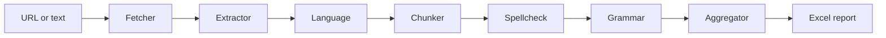

# Multi-Agent Spelling and Grammar Checker

A learning project that checks web pages (or plain text) for spelling, grammar and punctuation problems by chaining small, single-purpose agents. It detects the page language, proofreads in that language with an LLM (local Ollama or Groq), merges duplicate findings and writes an Excel report. Several URLs can be checked in one run.

## Projects

| Folder | Purpose |
|---|---|
| [minimal_spellchecker](minimal_spellchecker) | Smallest working multi-agent pipeline, heavily commented. Start here. |
| [my_spellchecker](my_spellchecker) | The fuller pipeline: URL fetching, language detection, chunking, aggregation, Excel report. |

## How it works

Each agent reads and updates one shared `PipelineState`. The orchestrator runs the agents in order and stops that URL's pipeline when an agent fails.



| Agent | File | Job |
|---|---|---|
| Fetcher | [fetcher_agent.py](my_spellchecker/agents/fetcher_agent.py) | Downloads the page HTML. |
| Extractor | [extractor_agent.py](my_spellchecker/agents/extractor_agent.py) | Removes menus and scripts, keeps headings, paragraphs and list items. |
| Language | [language_agent.py](my_spellchecker/agents/language_agent.py) | Detects the language per block, picks one page language, reports blocks in other languages. |
| Chunker | [chunker_agent.py](my_spellchecker/agents/chunker_agent.py) | Packs page-language blocks into chunks of at most `MAX_CHUNK_CHARS`. |
| Spellcheck | [spellcheck_agent.py](my_spellchecker/agents/spellcheck_agent.py) | Finds `spelling` and `foreign_word` issues. |
| Grammar | [grammer_agent.py](my_spellchecker/agents/grammer_agent.py) | Finds `grammar` and `punctuation` issues. |
| Aggregator | [aggregator_agent.py](my_spellchecker/agents/aggregator_agent.py) | Merges duplicates and counts repeats. |

[reporter.py](my_spellchecker/reporter.py) writes the Excel file. [orchestrator.py](my_spellchecker/orchestrator.py) wires the agents together.

## Setup

Requires Python 3.10 or newer.

```powershell
python -m venv .venv
.venv\Scripts\Activate.ps1
pip install -r my_spellchecker\requirements.txt
Copy-Item .env.example .env      # then edit .env
```

Choose a provider in `.env`:

- **Ollama (local, default):** install Ollama and run `ollama pull qwen2.5:7b`. Small models are English-centric, so use a multilingual one for non-English pages. Without a GPU it is slow.
- **Groq (cloud):** set `LLM_PROVIDER=groq` and `Groq_TOKEN`. Page text is sent to Groq. Model ids change over time, so set `GROQ_MODEL` to one your key can use.

## Usage

Run from the repository root.

```powershell
$env:PYTHONUTF8="1"

# plain text
python -m my_spellchecker.main --text "She go to the libary."

# one or more URLs
python -m my_spellchecker.main --url https://example.com --url https://en.wikipedia.org/wiki/Netherlands

# many URLs from a file (one per line, # for comments)
python -m my_spellchecker.main --urls-file my_spellchecker\urls.txt

# force the language, or choose the report path
python -m my_spellchecker.main --url https://nl.wikipedia.org/wiki/Nederland --lang Dutch --out report.xlsx
```

| Option | Meaning |
|---|---|
| `--text` | Check this text instead of a page. |
| `--url` | URL to check. Repeat for several. |
| `--urls-file` | File with one URL per line. |
| `--lang` | Force the page language (for example `Dutch`) instead of detecting it. |
| `--out` | Excel output path. URL runs default to `my_spellchecker/reports/spellcheck_report_<timestamp>.xlsx`. |

Environment variables: `LLM_PROVIDER`, `OLLAMA_MODEL`, `GROQ_MODEL`, `Groq_TOKEN`.

## Configuration

[my_spellchecker/config.py](my_spellchecker/config.py):

- `MAX_CHUNK_CHARS`: maximum characters per LLM call.
- `MAX_CHUNKS`: development limit on chunks per page. **Set to `0` to check the whole page.**
- `EXPECTED_LANGUAGES`: languages the detector can choose from.

## Excel report

- **Summary sheet:** one row per URL with status (`OK`, `PARTIAL`, `FAILED`), HTTP code, page language, blocks, chunks checked, issue counts per kind, API calls, tokens, seconds and errors.
- **Issues sheet:** one row per issue with URL, kind, text, suggestion, reason, chunk and repeat count.

## Known limitations

- LLM findings can be wrong. Brand names, slogans and loanwords are sometimes flagged as `foreign_word`.
- An allowlist and a validator agent that re-checks findings are not implemented yet.
- Language detection is per block. Very short blocks inherit the page language.
- Pages that need JavaScript to render are not supported (plain HTTP fetch only).

## Security

- Keep API keys only in `.env`. It is excluded by [.gitignore](.gitignore); [.env.example](.env.example) contains placeholders only.
- Check only pages you are allowed to fetch. Page text sent to a cloud provider leaves your machine.
